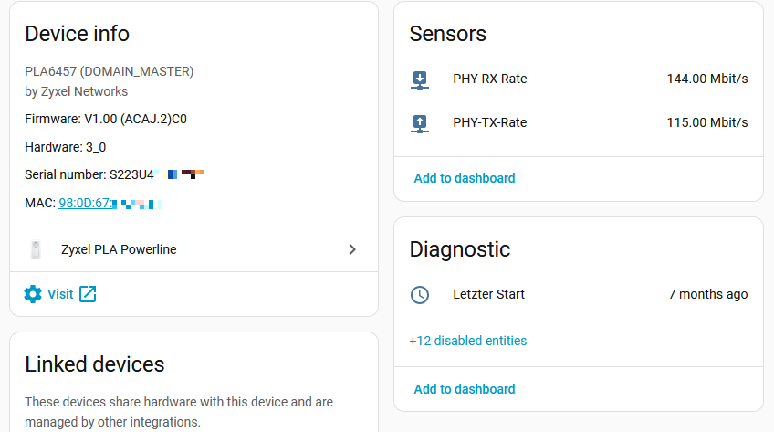
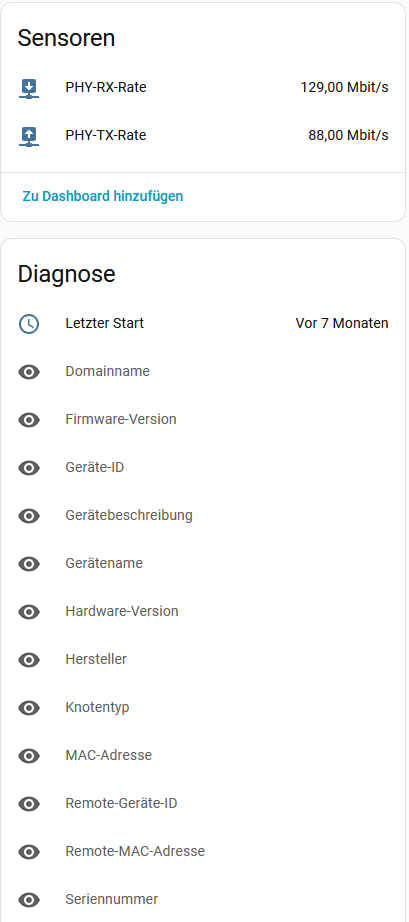

#  Zyxel PLA Powerline

Home Assistant custom integration for the **Zyxel PLA6457** G.hn powerline adapter.

It may also work with similar Zyxel PLA models that expose the same local web interface.

The integration logs into the adapter’s web UI and polls device information and link rates — no cloud service required.

<!-- Screenshot: integration card / device page -->

## Features

- Config flow setup (no YAML)
- Local polling only
- English and German translations
- Brand icon included

## Installation (HACS)

1. Open **HACS → Integrations**
2. Click the three dots (⋮) → **Custom repositories**
3. Add this repository:
   - **Repository:** `https://github.com/dieneuser/zyxel_pla`
   - **Category:** Integration
4. Click **Add**
5. Search for **Zyxel PLA Powerline** and install it
6. Restart Home Assistant

<!-- Screenshot: HACS custom repository dialog -->

## Configuration

1. Go to **Settings → Devices & services**
2. Click **Add integration**
3. Search for **Zyxel PLA**
4. Enter the **IP address** and **password** of your adapter
5. Optionally set a friendly name

<!-- Screenshot: config flow dialog -->

Default update interval: **60 seconds**.

## Sensors

| Sensor | Description | Unit |
|--------|-------------|------|
| MAC address | Adapter MAC address | – |
| Serial number | Device serial number | – |
| Firmware version | Installed firmware | – |
| Hardware version | Hardware revision | – |
| Last boot | Boot time (derived from uptime) | timestamp |
| Node type | `DOMAIN_MASTER` or `END_POINT` | – |
| Device ID | Local device ID on the powerline network | – |
| Domain name | Powerline domain name | – |
| Device name | Model name reported by the device | – |
| Device description | Full device description | – |
| Manufacturer | Manufacturer name | – |
| PHY TX rate | Transmit PHY rate to the paired adapter | Mbit/s |
| PHY RX rate | Receive PHY rate from the paired adapter | Mbit/s |
| Remote MAC address | MAC of the paired remote adapter | – |
| Remote device ID | Device ID of the paired remote adapter | – |

Some sensors are disabled by default and can be enabled in the entity registry.

<!-- Screenshot: sensors / device entities -->

## Notes

- PHY rates use the same formula as the device web UI: `floor(value × 32 / 1000)`.
- If multiple remote adapters are connected, the first link is exposed as the main TX/RX sensors. The full list is available in the coordinator data under `connections`.

## License

MIT
